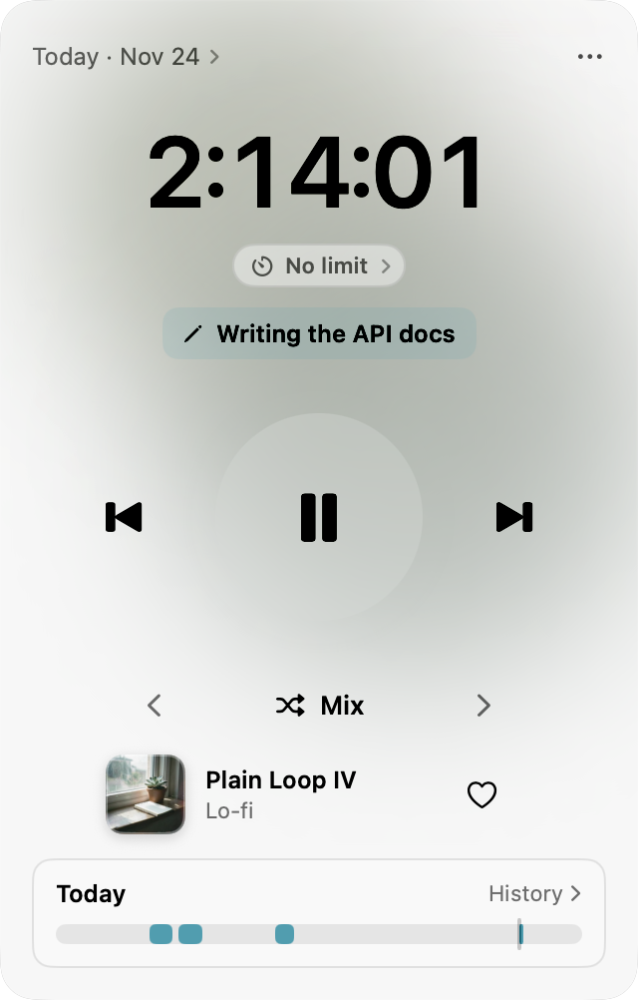
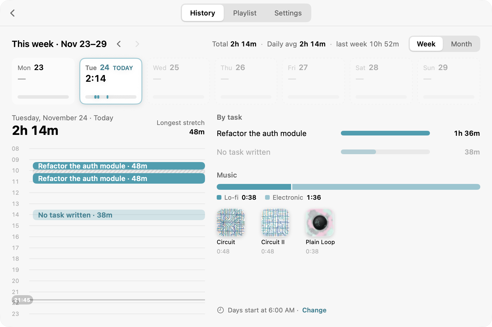

# ADHD Music

Plain, steady music for focused work. A free menu bar app for macOS, made for people with ADHD.

**Download:** https://adhdmusic.app/download (free, about 460 MB, macOS 26 or later, Apple silicon)




## What it is

ADHD Music lives in your Mac's menu bar and plays music that stays in the background. Press play and get to work.

It comes with 27 songs in Lo-fi (12), Grooves (8) and Electronic (7). Each one plays as a seamless 30-minute stretch.

## Why it helps you focus

- **No voices.** Lyrics pull your mind into words. There are none here.
- **No surprises.** ADHD brains react more to sudden sounds. Nothing jumps out here.
- **Just a loop.** One pattern on repeat, no tune to follow. It stays in the background.
- **A pulse on the beat.** A faint, steady pulse locked to the beat of every song. You choose how strong it is.

## What it does

- **Pauses by itself** when you step away, during calls, when your headphones come off, and when another app plays sound, like a YouTube video. Then it plays again.
- **Background sounds:** rain, waves, stream, and brown, pink or white noise under the music.
- **Timer, pomodoro or no limit.**
- **Today's focus time** in the menu bar. It only counts while music plays.
- **History:** a week strip, a timeline of your day, time per task and the music you heard, plus a month view.
- **Playlist:** one list, four ways to sort it, shuffle that keeps songs you just heard from coming back, songs you like more often, and one song on repeat when you want it.
- **Learns what you skip.** Songs you skip early come up less.
- **Keyboard:** the space bar plays and pauses; a global shortcut and the media keys work too.
- **Private.** No account, no analytics. Your history stays on your Mac.
- English and Korean.



## Install

1. Download the .dmg: https://adhdmusic.app/download
2. Open it and drag ADHD Music into Applications.
3. Open ADHD Music. It appears in your menu bar.
4. macOS asks once for System Audio Recording. Allow it: that is how the music pauses while a YouTube video plays. Nothing is recorded.

Requires macOS 26 or later on a Mac with Apple silicon.

## Automatic updates

The app you download from adhdmusic.app keeps itself up to date. About once a day it checks https://adhdmusic.app/appcast.xml. When there is a new version, it downloads it in the background (usually a small update), checks its signature, and installs it at a quiet moment: when the panel is closed and no music has played for 15 minutes, or when you quit the app. Nothing pops up. The check sends only the app's version number.

Updates use [Sparkle](https://sparkle-project.org). Builds you make yourself (below) don't update themselves, except a website build you sign and publish with your own feed.

## Build from source

The songs and their covers are not in this repository (see [ASSETS.md](ASSETS.md)). A build from this code starts with an empty playlist until you add your own songs ([Add your own songs](#add-your-own-songs)).

You need:

- macOS 26 or later on Apple silicon
- Xcode 26 or later, set as the active developer directory: `sudo xcode-select -s /Applications/Xcode.app/Contents/Developer` (the Command Line Tools alone lack `actool`, which builds the app icon)
- To add songs: Python 3.9 to 3.12 (macOS's own `/usr/bin/python3` is 3.9) and ffmpeg (`brew install ffmpeg`)

### Build the app

```bash
git clone https://github.com/lazydevz-inc/adhd-music.git
cd adhd-music
Scripts/build-app.sh --allow-missing-noise
open "dist/ADHD Music.app"
```

`--allow-missing-noise` builds without the rain, waves and stream loops, which are not in the repository either; those three stay silent. Brown, pink and white noise are made by the app and always work. To include the three loops, put seamless stereo FLAC loops at `Audio/Noise/LoopsShare/rain.flac`, `ocean.flac` and `stream.flac` (48,000 samples per second, the rate the app plays at) and build without the flag.

The script signs the app with your Apple Development certificate when you have one, and ad hoc otherwise. With ad hoc signing, macOS asks again for System Audio Recording after every build.

| Command | Result |
| --- | --- |
| `Scripts/build-app.sh` | `dist/ADHD Music.app`, app id `app.adhdmusic.local`, data in `~/Library/Application Support/Focus Music/` |
| `Scripts/build-app.sh --dev` | `build/Focus Music Dev.app`, app id `app.adhdmusic.local.dev`, data in `~/Library/Application Support/Focus Music Dev/` |
| add `--stub` | compiles against a silent stand-in for the sound engine (`Tests/Stubs/AudioEngineStub.swift`) |
| `Scripts/build-app.sh --share` | the website build with automatic updates (see [Make the .dmg](#make-the-dmg)) |
| `Scripts/build-app.sh --mas` | the Mac App Store build (see [Scripts/mas/README.md](Scripts/mas/README.md)) |

Your own builds keep their records, likes, learning and song library apart from the downloaded app, which uses `~/Library/Application Support/ADHD Music/`.

To try things without touching your records, start the app with its own data folder. Other development options: `--mute`, `--volume 0.03`, `--autoplay`, `--seed-demo` (a sample day of history), `--open-panel`, `--lang ko`, `--dark`, `--preview <page>`, `--scenario`, `--sound-log`.

```bash
"dist/ADHD Music.app/Contents/MacOS/FocusMusic" --data-dir ~/adhd-music-test --seed-demo --open-panel
```

### Add your own songs

1. Set up the song tools once:

   ```bash
   /usr/bin/python3 -m venv .venv-audio
   .venv-audio/bin/pip install -r Scripts/requirements-audio.txt
   ```

2. Put your WAV or FLAC files in `Audio/Songs/`. Git ignores `Audio/`.
3. Copy `Scripts/library-sources.example.json` to `Scripts/library-sources.json` and list your songs. Each entry has an `id` (lowercase letters, digits and dashes), a `title`, a `genre` (`lofi`, `grooves` or `electronic`), a `path` and a `status` (`new` or `inMix`). A one-line description in English and Korean, a cover picture and three colours are optional; the example file shows how.
4. Build the library:

   ```bash
   .venv-audio/bin/python Scripts/build_library.py \
     --library "$HOME/Library/Application Support/Focus Music/Library" \
     --sources Scripts/library-sources.json
   ```

   It copies each song into the library, sets its loudness, finds its beat for the pulse and picks the part that repeats for 30 minutes. A running app picks up the new list within 10 seconds. For the dev build use `Focus Music Dev/Library`; with `--data-dir`, use `<that folder>/Library`.

`Scripts/clean_endings.py` and `Scripts/trim_song_end.py` cut a song short when the part after its loop has a gap or loses the beat.

### Checks

```bash
Scripts/check-app-logic.sh                                # records, day boundaries, playlist, shuffle, learning
FOCUS_AUDIO_CHECKS=2,3,12 Scripts/check-audio-engine.sh   # sound engine checks that need no audio files
```

The full `Scripts/check-audio-engine.sh` also plays songs from `Audio/TestFixtures/` (`electronic-a.wav`, `electronic-b.wav`, `grooves-a.wav` and two reference renders in `comparisons/`) and the three noise loops. Those files are not in the repository. Without them the run names each missing file, skips the checks that need it, and fails. Nothing is heard: the engine runs offline or muted.

### Make the .dmg

`Scripts/package-share.sh` makes the website build: it builds the app with your songs inside and Sparkle for updates, signs it with your Developer ID, notarizes and staples it, wraps it in a .dmg in `dist/share/`, and writes a signed update feed in `dist/share/updates/`. Before you run it:

1. Fill in `Scripts/share/share.env` (the lines marked CHANGE): your Developer ID identity, your notarytool profile, and the keychain account of your own Sparkle key. The scripts stop while these are placeholders.
2. Get Sparkle: run `Scripts/share/get-sparkle.sh`. It downloads the official Sparkle release from GitHub into `build/vendor/` and checks its SHA-256 against `share.env`.
3. Make your update key once: `build/vendor/Sparkle-2.10.1/bin/generate_keys --account <name>`. Put the account name in `SHARE_SPARKLE_ACCOUNT` and the public key it prints in `SHARE_SPARKLE_PUBLIC_KEY`, and back up the private key: without it, installed copies can't update any more.
4. For a build you share: use your own `SHARE_NAME`, `SHARE_BUNDLE_ID`, `SHARE_FEED_URL` and `SHARE_UPDATES_URL`, and replace the icon and everything drawn from its design. The ADHD Music name and icon are not licensed to you (see [ASSETS.md](ASSETS.md)):
   - `Scripts/share/AppIcon.icon` (`band.svg`, `wave.svg`, `icon.json`) and `Scripts/share/icon_glyph.py`, which writes the two SVGs
   - the menu bar glyph drawn by `MenuBarIcon` in `Sources/App/AppShell.swift`
   - the wave arrow that `Scripts/share/dmg_background.swift` draws in the dmg window (or skip the designed window: without `build/.venv-dmg` the script makes a plain one)
5. Build your song library (the script bundles it from `~/Library/Application Support/Focus Music/Library`) and set up `.venv-audio`.
6. Put your own `rain.flac`, `ocean.flac` and `stream.flac` in `Audio/Noise/LoopsShare/`. The script refuses to build without them; `--allow-missing-noise` passes through for a local test only.

Each release: raise `SHARE_BUILD` in `share.env` (never reuse one), set `SHARE_VERSION`, and run `Scripts/package-share.sh`. At the end it checks the feed and every file it lists with the public key, the way the app will, and prints what to put online: `appcast.xml` at `SHARE_FEED_URL`, and the new .dmg and its delta files under `SHARE_UPDATES_URL`. Keep the older .dmgs in `dist/share/updates/`: the next release's deltas are made from them.

`Scripts/share/update-test.sh` tries the whole update on your Mac first: it builds two test versions with their own app id, data folder, local feed and a throwaway key, runs the older one, and checks that it updates itself while idle and waits while music plays.

The comments at the top of each script cover the details (the Xcode notarization route, the optional designed dmg window).

### Where things are

| Path | What |
| --- | --- |
| `Sources/App/` | The menu bar app: player, Timer & Sound, Playlist, History, Settings, pausing by itself, updates (`Updates.swift`, website build only) |
| `Sources/Audio/` | The sound engine: 30-minute seamless play, crossfades between songs, the pulse on the beat, background sounds |
| `Tests/` | Logic and sound engine checks |
| `Scripts/` | Build, checks and the song library tools |
| `Scripts/share/` | The website build: app icon, dmg window, signing and update settings, update test |
| `Scripts/mas/` | The Mac App Store build: sandbox, privacy manifest, account setup |
| `site/` | The website, adhdmusic.app (HTML and images; the videos and the audio clip are not in the repository) |

## Credits

Rain, waves and stream in the released app are made from these CC0 recordings on Freesound. Thank you to the people who recorded them.

- Rain: "Rain on grass and leaves" by SamsterBirdies, https://freesound.org/people/SamsterBirdies/sounds/584268/
- Waves: "waves on shingle beach" by brick_on_de (the first 1:45), https://freesound.org/people/brick_on_de/sounds/274135/
- Stream: "Stream Wyre forest 8.1.14" by turbostream (the first 2:45), https://freesound.org/people/turbostream/sounds/220528/

All three are under CC0 1.0: https://creativecommons.org/publicdomain/zero/1.0/

The website build updates itself with [Sparkle](https://sparkle-project.org) (MIT License), which ships inside that build with its license.

## License

The code is under the MIT License (see [LICENSE](LICENSE)). The music, cover art, app icon, the images in `site/`, and the name and brand ADHD Music are not; see [ASSETS.md](ASSETS.md).

---
